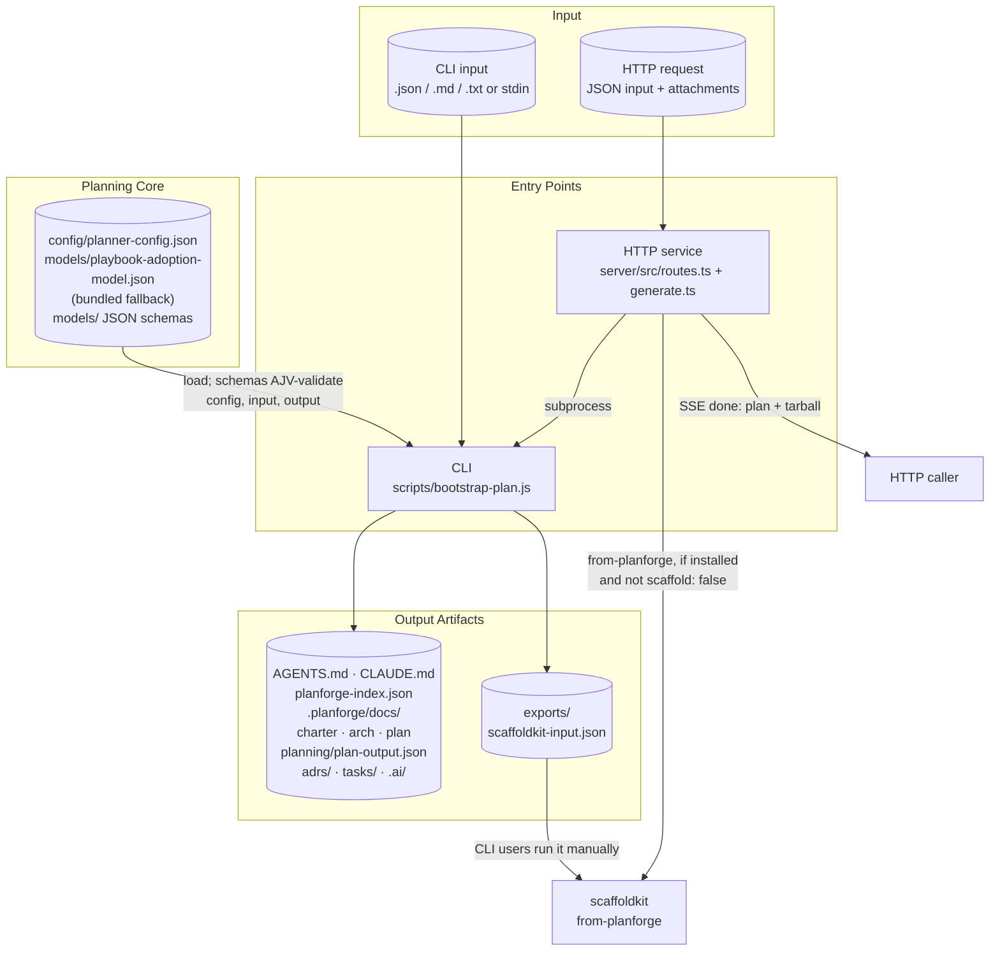
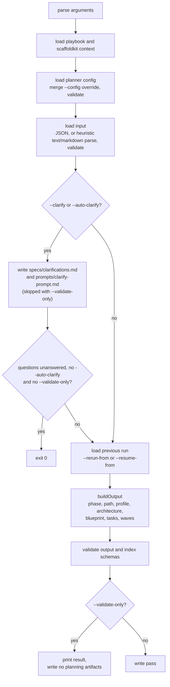
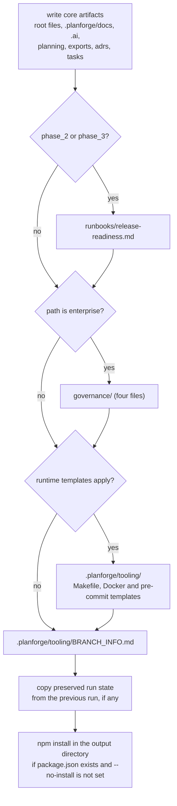

# Architecture

## How It Works

Planning input enters through the CLI or the HTTP service. The CLI reads JSON, markdown, or plain text from a file or standard input. The HTTP service takes a JSON planning-input object (text-tier attachments are prepended to its `summary`) and runs the CLI as a subprocess. Both drive the same planning core (planner config, playbook adoption model, schema validation), which writes a structured set of artifact directories plus `exports/scaffoldkit-input.json`. The HTTP service then runs scaffoldkit `from-planforge` on that export itself when scaffoldkit is installed and the request does not set `scaffold: false` (other skip reasons are listed in [server/README.md](../server/README.md)), and returns the whole output tree to the caller as a base64 tarball in the SSE `done` event. CLI users run scaffoldkit themselves.

The diagram shows both entry points with the input each accepts, the planning core, the generated artifacts, and the two ways scaffoldkit is reached.

The bundled `models/playbook-adoption-model.json` is used only when no external adoption model is found (see `AGENT_ENGINEERING_PLAYBOOK_ROOT` in [configuration.md](configuration.md#environment-variables-cli)).

### CLI Pipeline

One CLI run has a planning pass and a write pass. The planning pass loads context, config and input, optionally stops for clarification, builds the plan and validates it; `--validate-only` ends the run there, before the write pass. A `--clarify` or `--auto-clarify` run writes the clarification files first, except with `--validate-only`, which writes no files at all and does not stop for unanswered questions.

The write pass always writes the core artifacts, then the groups whose conditions hold (see [Phase, Path, And Profile](#phase-path-and-profile)), copies run state from a previous run, and runs `npm install` when the output directory has a `package.json`.

## Inputs And Outputs

The planning input is validated against `models/planning-input.schema.json`. Unknown keys fail validation. Text and markdown input is parsed heuristically into the same fields and validated against the same schema.

| Field | Required | Type or allowed values | Notes |
|---|---|---|---|
| `projectName` | yes | non-empty string | |
| `summary` | yes | non-empty string | |
| `targetUsers` | yes | array of strings, at least one | |
| `coreFeatures` | yes | array of strings, at least one | |
| `constraints` | yes | array of strings | |
| `nonFunctionalRequirements` | no | array of strings | |
| `integrations` | no | array of strings | |
| `plannerProfile` | no | `startup`, `product`, `enterprise`, `platform` | falls back to the planner config's `defaultProfile` |
| `dataSensitivity` | no | `low`, `moderate`, `high`, `regulated` | `high` and `regulated` force `phase_3` |
| `teamSize` | no | integer (at least 1), or `solo`, `small`, `medium`, `large`, `enterprise` | |
| `productionExpectedSoon` | no | boolean | |
| `liveUsers` | no | boolean | `true` forces at least `phase_2` |
| `enterpriseRequirements` | no | array of strings | any entry forces `phase_3` |
| `openQuestions` | no | array of strings | |
| `defaultBranch` | no | string | detected from the output directory's git `HEAD` when omitted, else `main` |

planforge produces a first planning package that also includes:

- intake completeness and targeted follow-up questions
- phase rationale and recommended artifacts
- explicit guidance areas beyond the local planning playbook

## Design Principles

- small, reviewable outputs beat ambitious but opaque planning
- default to the smallest architecture that satisfies current risk
- expose open questions and risks instead of pretending certainty
- keep generated artifacts editable by humans and agents
- ask for missing information explicitly when confidence would otherwise be fake

## Planning Model

`agent-planforge` follows the same delivery model as the broader playbook:

- spec-driven planning: make the intended outcome, scope, constraints, acceptance criteria, and risks explicit before implementation starts
- context-driven execution: provide enough architecture, domain, security, and operational context for downstream agents and humans to make sound decisions
- eval-driven delivery: carry forward the evidence needed to ship safely through tests, review, rollout readiness, and operational verification

### Phase, Path, And Profile

The CLI infers a delivery phase from the input. The first matching row wins:

| Phase | Condition |
|---|---|
| `phase_3` | `dataSensitivity` is `high` or `regulated`, or `enterpriseRequirements` has any entry |
| `phase_2` | `liveUsers` is `true` |
| `phase_1` | `productionExpectedSoon` is `true`, or `coreFeatures` has any entry |
| `phase_0` | none of the above |

The input schema requires at least one `coreFeatures` entry, so `phase_1` is the lowest phase a valid input reaches; `phase_0` does not occur for schema-valid input.

The path is `enterprise` for `phase_3` and `core` for every other phase.

Output groups gated by phase, path, or flags:

- `runbooks/release-readiness.md` for `phase_2` and `phase_3`
- `governance/` (`service-ownership.md`, `data-classification-matrix.md`, `access-review-plan.md`, `exception-register.md`) for the `enterprise` path
- `specs/clarifications.md` when `--clarify` or `--auto-clarify` is used

The profile is `plannerProfile` from the input, else `defaultProfile` from the planner config (`product` in the base `config/planner-config.json`). It selects the profile's guidance-area and artifact additions per phase and its intake policy (`nfrPriority`, `nfrBlocking`), and `platform` can also change the recommended scaffold blueprint. The profile does not change phase or path: an input with `plannerProfile: "enterprise"` but neither high or regulated data nor `enterpriseRequirements` gets no `governance/`.

## Current Scope

This version includes:

- a planning playbook
- an external planner ruleset in `config/planner-config.json`
- partial config override merge semantics (see [docs/configuration.md](configuration.md))
- JSON schemas for planning input and output
- a Node CLI that bootstraps planning artifacts from JSON, text, or markdown input
- gap detection for missing planning context
- reusable markdown templates for generated planning artifacts
- profile-aware planning modes for startup, product, enterprise, and platform work
- schema validation for input, config, and generated output
- `.ai/` context export for downstream coding agents
- playbook-aware charter and prompt references
- rerun/resume reporting and integration exports

## Related Tools

`agent-planforge` works best as part of a three-tool chain:

| Tool | Role |
|------|------|
| **agent-planforge** | Planning: turns rough requirements into architecture, tasks, and delivery plan |
| **[scaffoldkit](https://github.com/LanNguyenSi/scaffoldkit)** | Scaffolding: generates the initial repository structure from the planforge output |
| **[agent-engineering-playbook](https://github.com/LanNguyenSi/agent-dx/tree/master/packages/agent-engineering-playbook)** | Execution: a doc package in agent-dx that provides the coding agent with workflow, testing, and governance playbooks |

planforge produces an `exports/scaffoldkit-input.json` that wires directly into scaffoldkit. The generated root `AGENTS.md` points agents into `.ai/` and the grouped planning outputs so the downstream coding agent has a clean starting point from day one.

See [docs/scaffoldkit-planforge-workflow.md](scaffoldkit-planforge-workflow.md) for the detailed division of responsibility between scaffoldkit and planforge.

## Repository Structure

- `.github/`
- `CHANGELOG.md`
- `CODE_OF_CONDUCT.md`
- `CONTRIBUTING.md`
- `LICENSE`
- `SECURITY.md`
- `config/planner-config.json`
- `config/stack-patterns.json`
- `docs/`
- `examples/` (sample JSON and markdown inputs, minimal and platform inputs, a planner-config override)
- `models/planforge-index.schema.json`
- `models/planner-config.schema.json`
- `models/planning-input.schema.json`
- `models/planning-output.schema.json`
- `models/playbook-adoption-model.json`
- `playbooks/planning-and-scoping.md`
- `scripts/analyze-artifacts.js`
- `scripts/bootstrap-plan.js`
- `scripts/lib/`
- `scripts/refresh-example-outputs.js`
- `server/` (HTTP service sub-package)
- `templates/`
- `tests/`

## Testing

Run the automated suite with `npm test` (see [CONTRIBUTING.md](../CONTRIBUTING.md) for the full development workflow). The suite covers:

- golden-path planning for the sample JSON and markdown inputs, plus text input in summary mode
- scaffold blueprint selection and stack detection
- clarify and auto-clarify flows
- resume metadata and preserved run state
- schema validation failures for bad input, bad config, and rejected override keys
- config merge behavior
- consistency analysis
- playbook references and `.ai/` artifact generation
- `npm install` failure handling and the `--no-install` opt-out
- the HTTP service suite under `server/tests`, which `npm test` runs through `test:server`

The platform and minimal example inputs have no test case; CI runs the platform input with `--summary` in each CLI matrix job.
