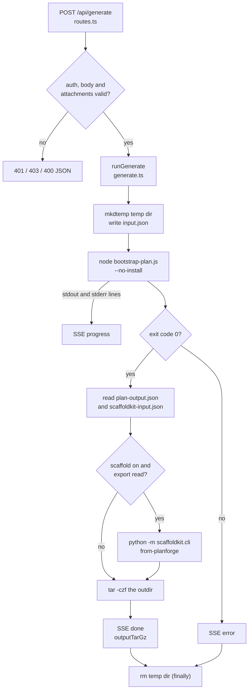

# HTTP generate pipeline

## Responsibility

- The `server/` package is a transport around the planning CLI: it
  authenticates a caller, turns one request into one CLI run in a private temp
  directory, optionally runs scaffoldkit on the result, and streams the outcome
  back as server-sent events. It does no planning of its own; every planning
  decision is the CLI's (see [CLI run overview](cli-run-overview.md)).

## Entry points

- `server/src/index.ts` runs the boot-time scaffoldkit probe, then starts the
  Hono app with `serve()` on `env.PORT`
  (`server/src/index.ts:6-8#"const server = serve({ fetch: app.fetch, port: env.PORT }"`).
- `GET /healthz` needs no token and reports `status: "ok"` plus the cached
  scaffoldkit probe result
  (`server/src/routes.ts:186-196#"scaffoldkitPython: getScaffoldkitStatus()"`).
- Every route under `/api` requires `Authorization: Bearer <token>`: no Bearer
  header gives 401 `unauthorized`
  (`server/src/routes.ts:206-209#"unauthorized"`), a token that does not match
  `PLANFORGE_SERVICE_TOKEN` gives 403 `forbidden`
  (`server/src/routes.ts:211-217#"forbidden"`). The comparison is
  constant-time
  (`server/src/routes.ts:170-180#"return timingSafeEqual(a, b)"`).
- `POST /api/generate` is the only API route.

## Configuration

`server/src/config.ts` parses the environment once with zod: `PORT`
(default 8223), `PLANFORGE_SERVICE_TOKEN` (required), `PLANFORGE_ROOT`
(default: two directories up from the module's own directory, which is the
repository root),
`NODE_BIN` (default: the running Node binary) and `SCAFFOLDKIT_PYTHON`
(default `/opt/sk-venv/bin/python3`)
(`server/src/config.ts:11-22#"SCAFFOLDKIT_PYTHON: z.string().default"`). An
invalid environment prints the issues and exits with code 1
(`server/src/config.ts:25-32#"process.exit(1)"`).

## Request handling

1. The body must parse as JSON and contain `input`; otherwise the route
   answers 400 `bad_request`
   (`server/src/routes.ts:241-245#"Body must be JSON"`,
   `server/src/routes.ts:247-251#"Body must be { input: <planning-input>"`).
2. `scaffold` defaults to true; only an explicit `false` turns it off
   (`server/src/routes.ts:263#".scaffold !== false"`).
3. `attachments` is optional. Each entry needs `name`, `mimeType` and a `tier`
   of `text`, `diagram` or `structured`. For `text` entries with
   `inlineText`, the texts are joined into "Additional context" blocks under a
   combined cap of `ATTACHMENTS_MAX_TOTAL_CHARS`
   (`server/src/routes.ts:38#"ATTACHMENTS_MAX_TOTAL_CHARS = 50_000"`)
   (`server/src/routes.ts:113-126#"Additional context from attachment"`).
   Over the cap the route answers 400 `attachments_too_large`; under it the
   block is prepended to `input.summary`, and the `attachments` field itself
   never reaches the CLI
   (`server/src/routes.ts:272-280#"augmentInputWithContext(input"`). When
   `input` is not an object, the service replaces it with
   `{ summary: <block> }` and lets the CLI's schema check report the problem
   (`server/src/routes.ts:148-161#"summary: combined"`). `diagram` and
   `structured` entries are validated and otherwise ignored.
4. A client disconnect aborts a controller that `runGenerate` listens to
   (`server/src/routes.ts:288-289#"controller.abort()"`).
5. Every event from `runGenerate` is written as one SSE frame named after the
   event type
   (`server/src/routes.ts:302-304#"data: JSON.stringify(ev)"`). An exception
   thrown out of the generator becomes a final `error` frame that carries the
   last seen `requestId`
   (`server/src/routes.ts:307-315#"message: (err as Error).message"`).

## The per-request pipeline (`runGenerate`)

The diagram shows the main path of one request through `routes.ts` and
`generate.ts`; the error branches after a successful CLI exit are listed in
the steps below it.

1. **Temp dir.** A temp directory named after a fresh request id is created
   (`server/src/generate.ts:332-337#"mkdtemp(resolve(tmpdir()"`), and the
   request's `input` is written to `input.json` with `JSON.stringify` and file
   mode 0600 (`server/src/generate.ts:352#"mode: 0o600"`).
2. **CLI run.** The CLI is spawned with `--input`, `--outdir` and
   `--no-install` only, in the temp dir
   (`server/src/generate.ts:354-358#"cwd: tmp"`). No `--format` is passed,
   so the CLI's `json` default applies
   (`scripts/bootstrap-plan.js:31#"format:"`), and no previous-run
   flag is passed, so every service run is a fresh run. The abort signal kills
   the child with SIGTERM
   (`server/src/generate.ts:370-373#"addEventListener"`).
3. **Progress.** stdout and stderr are split into lines, and each line becomes
   a `progress` event tagged with its stream
   (`server/src/generate.ts:398-402#"requestId, stream: tag, line"`).
4. **Exit.** A spawn failure emits one `error` event and ends the run
   (`server/src/generate.ts:425-427#"message: err.message"`). A non-zero exit
   emits `error` with the exit code
   (`server/src/generate.ts:447-451#"planforge CLI exited with code"`).
5. **Read results.** After exit 0, an unreadable `planning/plan-output.json`
   ends the run with `error`
   (`server/src/generate.ts:459-467#"Failed to read plan-output.json"`). A
   missing `exports/scaffoldkit-input.json` sets the export to `null`; any
   other read or parse failure is kept as `inputReadError`
   (`server/src/generate.ts:479-484#"scaffoldkitInputReadError = (err as Error).message"`).
   The CLI writes that export on every run that reaches its write step
   (`scripts/bootstrap-plan.js:3347-3349#"renderScaffoldKitInput(input, output, scaffoldkitContext)"`),
   so with the current CLI a missing export after exit 0 is not expected.
6. **Scaffold decision.** `scaffold: false` gives `skipped: "opt_out"`, a
   read failure gives `input_unreadable`, a missing export gives `no_input`
   (`server/src/generate.ts:492-501#"no_input"`). Otherwise `runScaffoldkit`
   runs; an `ENOENT` spawn error gives `skipped: "not_installed"`, and any
   other spawn error ends the run with `error`
   (`server/src/generate.ts:511-522#"Failed to spawn scaffoldkit"`).
7. **Scaffoldkit subprocess.** The arguments are
   `-m scaffoldkit.cli from-planforge <export> --target <outdir> --overwrite --no-install --no-ai-context`
   (`server/src/generate.ts:222-233#"--no-ai-context"`). A non-zero exit is
   returned as data, not thrown
   (`server/src/generate.ts:304#"exitCode: code ?? -1"`), so a failed scaffold
   still produces a `done` event. Captured stderr is capped at 4096 bytes
   (`server/src/generate.ts:187#"SCAFFOLDKIT_STDERR_MAX_BYTES = 4096"`).
   After five minutes
   (`server/src/generate.ts:171#"SCAFFOLDKIT_TIMEOUT_MS = 5 * 60_000"`) the
   watchdog sends SIGTERM
   (`server/src/generate.ts:269-271#"if (!child.killed) child.kill("`). It also
   schedules a SIGKILL five seconds later, guarded by
   `child.exitCode === null && child.signalCode === null`
   (`server/src/generate.ts:272-276#"}, 5_000);"`), not by `child.killed`,
   because Node sets `killed` as soon as the SIGTERM is delivered, not when the
   child exits. So a child that ignores SIGTERM is force-killed five seconds
   later. Either way the request ends with `exitCode: -1` and a timeout
   message (`server/src/generate.ts:297-300#"scaffoldkit timed out after"`).
   A
   client disconnect also sends SIGTERM
   (`server/src/generate.ts:284-287#"args.abortSignal?.addEventListener"`).
8. **Tarball.** The outdir contents are packed with the system `tar`
   (`server/src/generate.ts:317-322#"maxBuffer: TARBALL_MAX_BYTES"`), with a
   cap of 50 MiB (`server/src/generate.ts:161#"TARBALL_MAX_BYTES = 50 * 1024 * 1024"`).
   An oversized or failed tar ends the run with `error`; otherwise the tarball
   is base64-encoded
   (`server/src/generate.ts:536-547#"buf.toString"`).
9. **Done.** The `done` event carries `planOutput`, `scaffoldkitInput`, the
   `scaffoldkit` result object, `outputTarGz` and `exitCode: 0`
   (`server/src/generate.ts:558-565#"exitCode: 0"`).
10. **Cleanup.** A `finally` block removes the abort listener and deletes the
    temp dir on every path, success or failure
    (`server/src/generate.ts:567-569#"rm(tmp, { recursive: true, force: true })"`).

## Boot probe versus per-request skip reasons

- `boot-guard.ts` checks once whether `SCAFFOLDKIT_PYTHON` is executable
  (`fs.constants.X_OK`) and caches the answer for the process lifetime
  (`server/src/boot-guard.ts:9-14#"missing"`,
  `server/src/boot-guard.ts:23-25#"return cachedStatus"`). At boot a
  `missing` result prints a warning, shortened to one line when
  `PLANFORGE_ALLOW_MISSING_SCAFFOLDKIT=1`
  (`server/src/boot-guard.ts:47#"const allowMissing"`). The probe never
  changes `/healthz`'s `status` and never gates a request. The loud warning
  names both per-request outcomes described next, since the probe cannot tell
  a missing path from a non-executable one.
- Per request, only `ENOENT` from spawning the Python binary maps to
  `skipped: "not_installed"`. A path that exists but is not executable fails
  the spawn with `EACCES`, which ends the request with an `error` event
  ("Failed to spawn scaffoldkit") instead.
