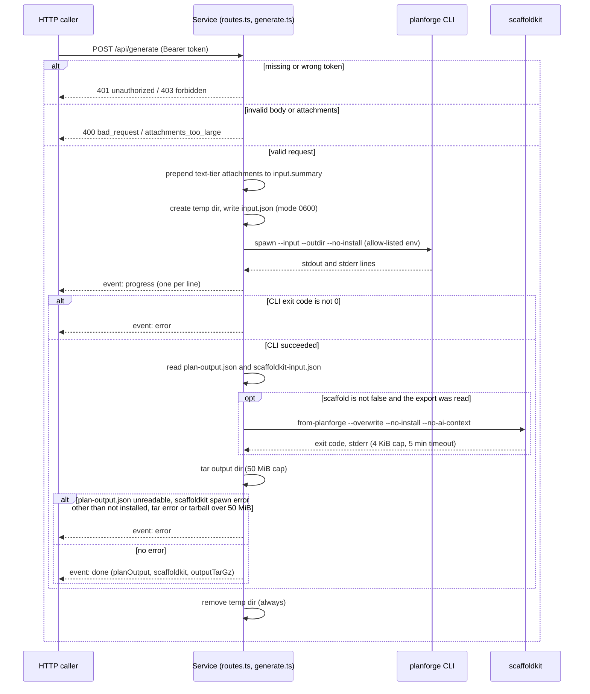

# agent-planforge HTTP service

Thin Hono + TypeScript HTTP surface around `scripts/bootstrap-plan.js`. Lets
project-forge (and agents) drive the planner over the network instead of
shelling out to the CLI on the same machine.

Designed in [project-forge ADR-0002](https://github.com/LanNguyenSi/project-forge/blob/main/docs/adrs/0002-tool-decoupling-service-boundary.md);
this package is follow-up ticket #1 from that ADR.

## Endpoints

| Route | Auth | Purpose |
| --- | --- | --- |
| `GET  /healthz` | none | Liveness + scaffoldkit-python probe. Traefik / ops dashboard target. |
| `POST /api/generate` | `Bearer ${PLANFORGE_SERVICE_TOKEN}` | Run the planner. Streams progress as SSE. |

### `POST /api/generate`

Request:

```json
{
  "input": { /* planning input — same schema the CLI's --input accepts */ },
  "scaffold": true,
  "attachments": [
    {
      "name": "arc42.md",
      "mimeType": "text/markdown",
      "tier": "text",
      "inlineText": "# Architecture\n..."
    }
  ]
}
```

- `scaffold` — optional, default `true`. When `true`, the service invokes
  scaffoldkit against the planforge-produced `scaffoldkit-input.json` and
  the resulting project tree lands in the response tarball alongside the
  planning artifacts. Set to `false` for planning-only runs (preview UIs,
  callers that scaffold separately, tests). scaffoldkit runs as
  `from-planforge --overwrite --no-install --no-ai-context` against the
  CLI's output directory.
- `attachments` — optional. Array of `{ name, mimeType, tier, inlineText?, contentRef? }`
  where `tier` is one of `text | diagram | structured`. Shape is validated
  at the edge (400 `bad_request` on malformed entries).
  - **Text tier** (`tier: "text"`, `inlineText` present): the service
    prepends each entry as an "Additional context from attachment: &lt;name&gt;"
    markdown block onto `input.summary` before invoking the CLI. The
    augmented summary flows through every existing CLI prompt template
    slot (clarify, architecture, intake) without schema changes.
  - **Total-char cap**: sum of all text-tier `inlineText` lengths must
    be ≤ 50,000 chars. Exceeding it returns 400 `attachments_too_large`.
    Fail-fast by design — silent truncation risks dropping architecturally
    important sections.
  - **Diagram / structured tiers** are shape-validated but remain no-ops
    at the prompt level until later slices (vision pass, drawio/puml
    parsers).
  - Attachments are **not** forwarded to the CLI's `input.json` as a
    separate field; they stay in the service layer so the CLI schema
    stays stable across slices.
  - **Side effect worth knowing**: `input.summary` is *also* regex-scanned
    by the CLI for architecture heuristics (e.g. database-store inference
    via phrases like `filesystem is the source of truth` or `no external
    database` in `scripts/bootstrap-plan.js`). Attachment content
    containing those phrases will influence those decisions. That's by
    design — real architectural text SHOULD shape the plan — but clients
    surfacing this upload in a UI should make it clear that attached
    documents influence the generated plan beyond prompt interpolation.

Request flow: the sequence below shows what one request does, where it
can fail, and which subprocesses run.



The temp directory is removed on success, failure and client disconnect;
planning artifacts are returned even when scaffoldkit exits non-zero, times
out, or is not installed.

Response: `Content-Type: text/event-stream`. Events:

- `progress` — `{ requestId, stream: "stdout" | "stderr", line }` — one per
  CLI log line
- `done` — `{ requestId, planOutput, scaffoldkitInput: <object> | null, scaffoldkit: { invoked, exitCode?, stderr?, skipped?, inputReadError? }, outputTarGz: <base64 gzip tarball>, exitCode: 0 }`. The tarball packs the **contents** of the CLI's output dir (not a nested `out/` folder); untar with `tar -xzf - -C <targetDir>`. Hard cap: 50 MiB (gzipped) — raised from 10 MiB when scaffolding landed because a scaffolded project tree can be several MB. Large enough for typical runs and keeps a pathological prompt from streaming an unbounded blob into the client's memory.
- `error` — `{ requestId, message, exitCode? }`

The `scaffoldkit` field on `done` always exists. Its `skipped` value
tells callers why scaffolding was not performed:

| `skipped` | Meaning |
| --- | --- |
| `opt_out` | Caller passed `scaffold: false` |
| `no_input` | `scaffoldkit-input.json` was missing after a successful CLI run. The current CLI writes it on every successful run, so this indicates a CLI regression rather than a property of the input. |
| `input_unreadable` | `scaffoldkit-input.json` exists but read / `JSON.parse` failed — almost always a CLI bug. The underlying error message is in `inputReadError` so callers can distinguish a parse failure from a permission issue. |
| `not_installed` | `SCAFFOLDKIT_PYTHON` does not exist (`ENOENT`) — dev env without the venv; production containers always have it. A path that exists but is not executable is not a skip: the request ends with an SSE `error` event ("Failed to spawn scaffoldkit"). |

A nonzero `scaffoldkit.exitCode` does **not** fail the request — planning
artifacts are still returned, and the caller decides whether the failed
scaffold is fatal to its flow.

## Environment

| Var | Default | Notes |
| --- | --- | --- |
| `PORT` | `8223` | TCP port |
| `PLANFORGE_SERVICE_TOKEN` | *(required)* | Bearer token clients present |
| `PLANFORGE_ROOT` | parent of this package | Repo root that contains `scripts/bootstrap-plan.js` |
| `NODE_BIN` | `process.execPath` | Node binary used to spawn the CLI |
| `SCAFFOLDKIT_PYTHON` | `/opt/sk-venv/bin/python3` | Python binary that runs `scaffoldkit.cli from-planforge`. The Dockerfile lays down the pinned venv; local dev points this at any Python that has scaffoldkit installed, or skips scaffolding via `scaffold: false` in the request body. |
| `PLANFORGE_ALLOW_MISSING_SCAFFOLDKIT` | *(unset)* | Set to `1` to acknowledge a dev env without scaffoldkit: downgrades the missing-`SCAFFOLDKIT_PYTHON` boot warning to a single info line. Unset, the service still boots but logs a loud multi-line warning. |

## Security Model And Limits

- **Auth**: one shared bearer token (`PLANFORGE_SERVICE_TOKEN`) for every
  `/api` route, compared in constant time, with no scopes. A request
  without a `Bearer` header gets 401 `unauthorized`; a wrong token gets
  403 `forbidden`.
- **Health**: `GET /healthz` needs no token and returns
  `{ status, service, uptime, scaffoldkitPython }`, where
  `scaffoldkitPython` is `ok` or `missing`. `missing` does not change
  `status`.
- **Network**: the service listens on all interfaces at the configured
  `PORT`. Run it on a private network or behind a proxy.
- **Limits**: there is no request-body, rate or concurrency limit.
  Text-tier attachments are capped at 50,000 chars in total. The planner
  CLI subprocess has no timeout. scaffoldkit is stopped after 5 minutes
  (SIGTERM, then SIGKILL 5 seconds later if it has still not exited, so a
  child that ignores SIGTERM is force-killed) and reported as
  `exitCode: -1`, with its stderr cut to 4 KiB. The `done` tarball is capped at 50 MiB.
- **Isolation**: the CLI and scaffoldkit subprocesses receive only `PATH`,
  `HOME`, `NODE_ENV`, `TMPDIR`, `LANG` and `LC_ALL` from the service's
  environment. Each request uses its own temp directory with `input.json`
  at mode 0600, removed on success, failure and client disconnect. A
  client disconnect terminates the running subprocess. Request bodies are
  not logged.
- **Errors**: 400 `bad_request` (body not JSON, missing `input`, malformed
  `attachments`), 400 `attachments_too_large`, 401 `unauthorized`, 403
  `forbidden`, and SSE `error` events once streaming has started.

## Running

Install dependencies first: `npm install` in the repository root (the
planner CLI the service spawns needs the root package's dependencies) and
`npm install` in `server/`.

Dev (reloads on edit):

```bash
PLANFORGE_SERVICE_TOKEN=dev-token npm run dev
```

Production build:

```bash
npm run build
PLANFORGE_SERVICE_TOKEN=<token> npm start
```

Container (see `Dockerfile`):

```bash
docker build -f server/Dockerfile -t agent-planforge .
docker run -p 8223:8223 -e PLANFORGE_SERVICE_TOKEN=<token> agent-planforge
```

## Tests

```bash
npm test
```

The route suites (`tests/routes.test.ts`, `tests/routes.sse-spawn-error.test.ts`)
call the Hono app through `app.fetch()`;
`tests/node-server-adapter.test.ts` serves it through `@hono/node-server` on
an ephemeral loopback port to cover the socket and SSE streaming path. The
route tests exercise the real CLI against `examples/sample-input.json`.
Typical runtime is a few hundred milliseconds per test on a warm cache.

CI also runs `npm run typecheck`, `npm run build` and `npm run test:coverage`;
the coverage run enforces the thresholds in `vitest.config.ts`.
